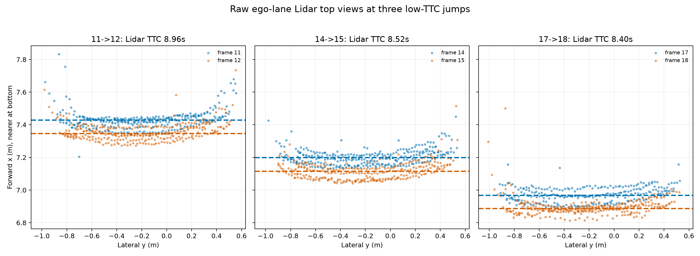
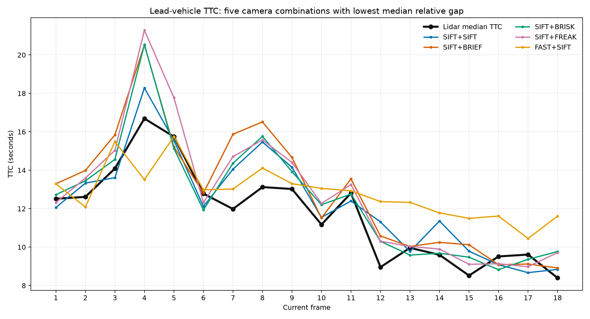
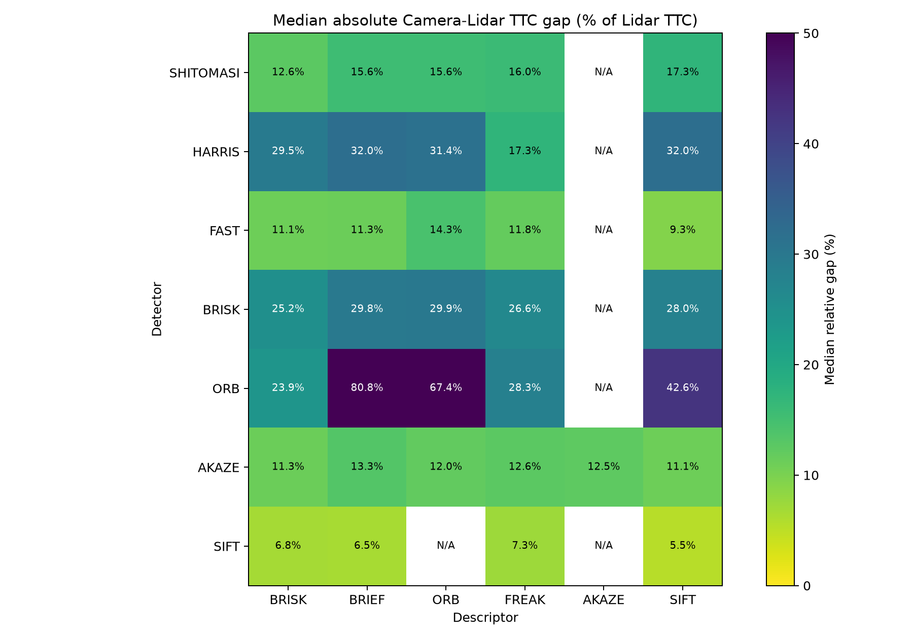
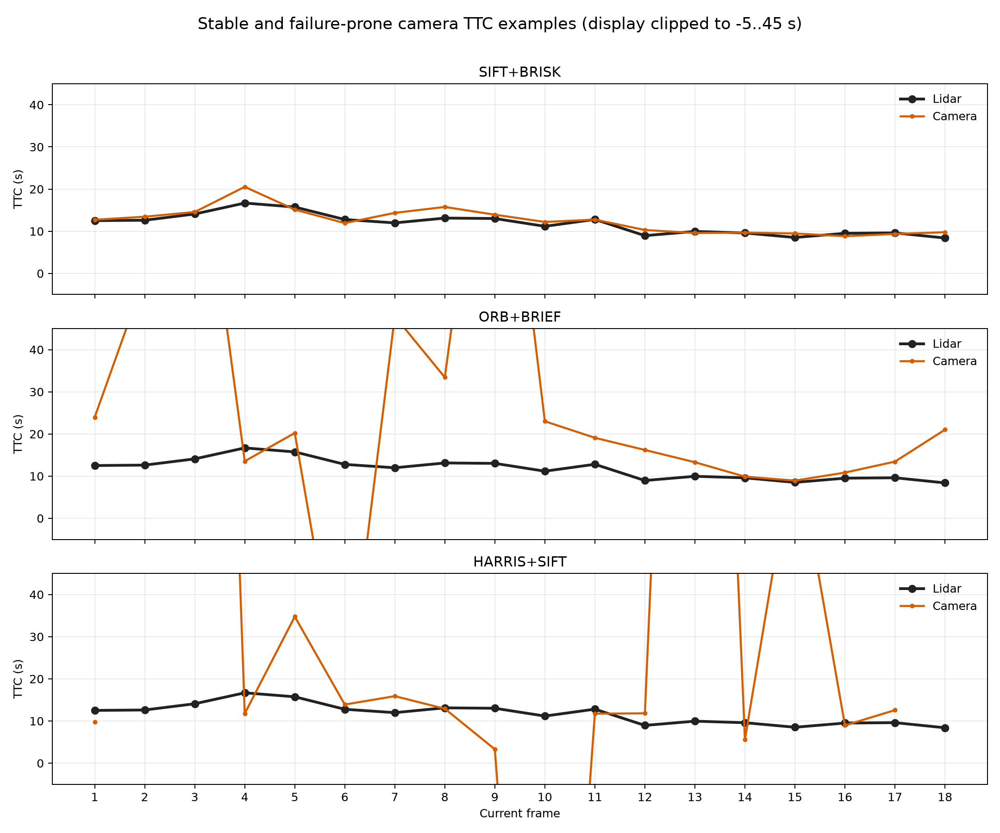

# SFND 3D Object Tracking

This project tracks 3D objects between consecutive KITTI camera/Lidar frames and estimates time-to-collision (TTC) independently from both sensors. The implementation covers every rubric item FP.0-FP.6 and includes reproducible tests, frame-level benchmark data, and figures for all valid detector/descriptor combinations.

## Build and Run

Dependencies are CMake 3.10+, a C++14 compiler, and OpenCV 4.1+ with the contrib modules. The official YOLOv3 weight file is managed by Git LFS.

```bash
cmake -S . -B build
cmake --build build -- -j4
cd build && ctest --output-on-failure

# Run one detector/descriptor combination without GUI windows.
./3D_object_tracking FAST BRIEF --data .. --output ../results/fast_brief.csv
```

The executable accepts all detectors and descriptors from the preceding 2D feature-tracking project. `--visualize` enables the TTC overlay; the default is headless so benchmarks can run unattended.

```bash
# Optional sharding across workers.
scripts/run_benchmark.sh build/3D_object_tracking results/raw/a 0 2
scripts/run_benchmark.sh build/3D_object_tracking results/raw/b 1 2

python3 scripts/merge_benchmarks.py results/raw \
  --output results/ttc_benchmark.csv \
  --summary results/ttc_summary.csv
```

## FP.0 Final Report

The implementation is primarily in:

- [`src/camFusion_Student.cpp`](src/camFusion_Student.cpp): bounding-box matching, ROI match filtering, and both TTC estimators.
- [`src/FinalProject_Camera.cpp`](src/FinalProject_Camera.cpp): the complete frame pipeline, command-line selection, unique lead-object selection, and CSV output.
- [`src/matching2D_Student.cpp`](src/matching2D_Student.cpp): seven detectors, six descriptors, BF/FLANN matching, and NN/KNN selection.
- [`tests/fusion_tests.cpp`](tests/fusion_tests.cpp): deterministic checks for FP.1-FP.4, including synthetic outliers.

The complete frame-level data is in [`results/ttc_benchmark.csv`](results/ttc_benchmark.csv), and the per-combination metrics are in [`results/ttc_summary.csv`](results/ttc_summary.csv).

## FP.1 Match 3D Objects

`matchBoundingBoxes` examines every valid keypoint match. If the previous keypoint is inside a previous-frame ROI and the current keypoint is inside a current-frame ROI, that `(previous boxID, current boxID)` pair receives one vote. For each previous box, the current box with the greatest vote count is stored in `bbBestMatches`. Invalid match indices and zero-vote boxes are ignored.

This uses the keypoint evidence directly and remains deterministic when detections overlap. The main pipeline additionally selects one lead-object pair with valid Lidar data for each frame transition so repeated overlapping detections do not duplicate benchmark rows.

## FP.2 Compute Lidar-Based TTC

`computeTTCLidar` rejects non-finite and non-forward points, then uses the median forward distance in each matched bounding box. The median is robust to isolated points on the road, neighboring vehicles, or the far side of the object. For frame interval `dt`, TTC is:

```text
TTC = d_current * dt / (d_previous - d_current)
```

Empty point sets return `NaN`, and a near-zero closing distance returns infinity rather than dividing by zero.

## FP.3 Associate Keypoint Correspondences with Bounding Boxes

`clusterKptMatchesWithROI` first keeps matches whose current keypoint lies inside the target ROI. It measures the Euclidean displacement of each retained correspondence and computes the median and median absolute deviation (MAD). A match is retained when its displacement is no greater than:

```text
median displacement + 2.5 * robust sigma
robust sigma = 1.4826 * MAD
```

A small scale fallback handles a zero MAD. Both `boundingBox.kptMatches` and `boundingBox.keypoints` are populated from the same filtered candidates.

## FP.4 Compute Camera-Based TTC

`computeTTCCamera` forms all independent pairs of ROI-filtered keypoint matches. For each pair it calculates the ratio between current and previous keypoint separation. Pairs closer than 100 pixels in the current image are skipped because small baselines amplify localization noise. The median ratio suppresses individual bad correspondences:

```text
ratio_i,j = current separation_i,j / previous separation_i,j
TTC = -dt / (1 - median ratio)
```

Insufficient matches produce `NaN`; a ratio effectively equal to one produces infinity. These states remain visible in the CSV instead of being silently replaced.

## FP.5 Lidar Performance Evaluation

All combinations produce the same Lidar series because feature selection does not affect the Lidar estimator. The top views below overlay raw ego-lane returns from consecutive frames; dashed lines show the matched lead-box median distances used by the estimator.



Three low-TTC jumps deserve attention:

| Frames | Median distance change | Lidar TTC | Observation |
| --- | ---: | ---: | --- |
| 11 -> 12 | 7.429 m -> 7.347 m | 8.96 s | The 8.2 cm step is substantially larger than the preceding 5.8 cm step (12.81 s). |
| 14 -> 15 | 7.199 m -> 7.115 m | 8.52 s | The rear-surface return band shifts downward and changes density across the ROI. |
| 17 -> 18 | 6.969 m -> 6.887 m | 8.40 s | The 8.2 cm step follows a 7.25 cm step (9.61 s), producing another abrupt TTC drop. |

The top views show that the sensor does not sample exactly the same rear-surface points in every scan. Occlusion, reflectivity, scan-line placement, and small projection/bounding-box changes alter the distribution of returns. Even with a median, a 2-3 cm change in the estimated 0.1-second closing step moves TTC by several seconds because that step is the denominator of the formula. A production system should smooth distance/relative velocity over several frames and fuse Camera and Lidar estimates.

## FP.6 Camera Performance Evaluation

The benchmark ran 35 valid combinations over all 19 images, giving 18 unique lead-object frame transitions per combination. AKAZE descriptors are only valid with AKAZE keypoints, and SIFT keypoints with the ORB descriptor are excluded because that OpenCV pairing is incompatible.





The primary metric is median absolute Camera-Lidar gap divided by Lidar TTC. An outlier is a non-finite/non-positive Camera TTC or a positive Camera TTC more than 25% away from Lidar.

| Detector + descriptor | Valid Camera frames | Median relative gap | Outliers |
| --- | ---: | ---: | ---: |
| SIFT + SIFT | 18/18 | 5.47% | 1 |
| SIFT + BRIEF | 18/18 | 6.50% | 2 |
| **SIFT + BRISK** | **18/18** | **6.79%** | **0** |
| SIFT + FREAK | 18/18 | 7.32% | 1 |
| FAST + SIFT | 18/18 | 9.32% | 3 |

`SIFT+SIFT` has the smallest median gap, but `SIFT+BRISK` is the best operational choice: it is the only combination with 18 finite estimates and zero outliers under the 25% rule. SIFT keypoints provide stable scale-aware geometry on the lead vehicle, while BRISK supplies enough reliable correspondences without the sparse behavior seen with Harris or ORB detectors.



Failure examples make the denominator sensitivity clear:

- `ORB+BRIEF`, frame 3: Camera TTC is 102.10 s versus Lidar 14.09 s with only 46 ROI matches. Frame 6 flips to -48.15 s with 17 matches, and frame 9 jumps to 121.25 s with 38 matches.
- `HARRIS+SIFT`, frame 3: Camera TTC reaches 346.02 s with 10 matches. It becomes -153.93 s at frame 10 and 284.16 s at frame 13, again with only 10-13 matches.
- `SIFT+BRISK` has no invalid or greater-than-25% frame in this sequence.

Sparse or poorly distributed matches make the median distance ratio approach one, causing very large TTC, or cross below one, causing negative TTC. The full CSV and heatmap preserve every result rather than selecting only favorable frames.
