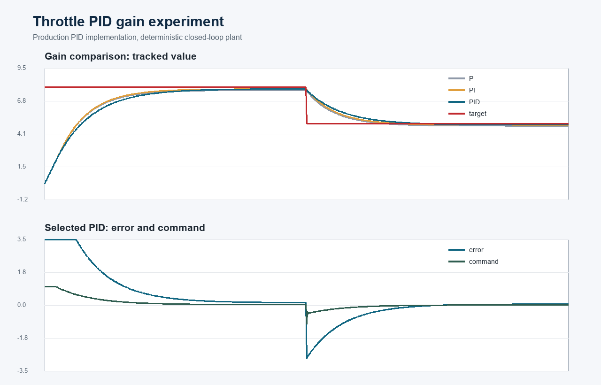
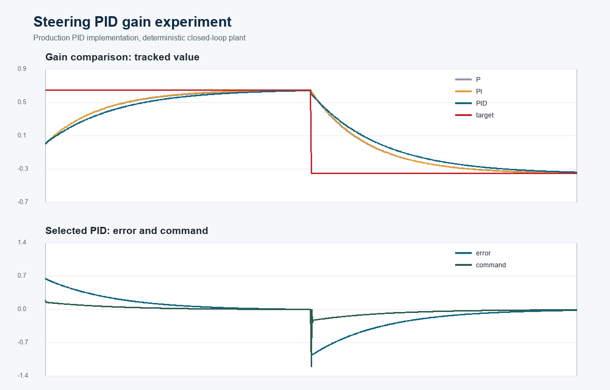

# Control and Trajectory Tracking Report

## Controller Design

The project uses two instances of the same discrete PID controller. The
steering controller is limited to `[-1.2, 1.2]`; the longitudinal controller is
limited to `[-1.0, 1.0]`, where positive output is throttle and negative output
is converted to brake.

For sample interval `dt`, the implementation updates:

```text
p_error = error
i_error = i_error + error * dt
d_error = (error - previous_error) / dt
command = clamp(Kp*p_error + Ki*i_error + Kd*d_error)
```

The first derivative sample is zero, invalid sample intervals retain a safe
default, and integral anti-windup limits the I-term contribution to the command
range.

## Tracking Errors

The longitudinal error is:

```text
error_throttle = planned_velocity.back() - measured_velocity
```

A positive value means the car is too slow. A negative value produces a
negative longitudinal command, which `main.cpp` converts to braking.

The lateral error is:

```text
desired_yaw = atan2(planned_y.back() - ego_y,
                    planned_x.back() - ego_x)
error_steer = normalize_angle(desired_yaw - measured_yaw)
```

Normalization avoids a discontinuity when an angle crosses `-pi` or `pi`.
Both calculations are isolated in `control_errors.cpp` and called directly by
the simulator entry point.

## Gain Selection

I tested proportional-only, proportional-integral, and full PID variants while
changing one term at a time. The final values balance convergence and command
smoothness:

| Controller | Kp | Ki | Kd |
| --- | ---: | ---: | ---: |
| Throttle P | 0.20 | 0 | 0 |
| Throttle PI | 0.20 | 0.0009 | 0 |
| **Throttle PID selected** | **0.20** | **0.0009** | **0.10** |
| Steering P | 0.30 | 0 | 0 |
| Steering PI | 0.30 | 0.0010 | 0 |
| **Steering PID selected** | **0.30** | **0.0010** | **0.30** |

I first increased `Kp` until tracking became responsive, introduced a small
`Ki` to reduce persistent bias, and then increased `Kd` to damp abrupt target
changes. Larger integral gains accumulated excessive correction; larger
derivative gains made commands react too sharply to target steps.

## Response Plots

The following reproducible gain experiments compile and execute the production
PID and error sources against a deterministic first-order plant. They provide a
dependency-isolated comparison; CARLA itself remains the final integration
environment and writes live logs for `project/plot_pid.py`.



The throttle target steps from 8 m/s to 5 m/s. The controller first produces
positive throttle, then a negative command for braking. The error converges
toward zero in both regimes, and all output remains inside `[-1, 1]`.



The desired heading changes from 0.65 rad to -0.35 rad. The selected controller
turns in the correct direction, its derivative term reacts to the heading step,
and the command remains inside `[-1.2, 1.2]` while the angular error decays.

## P, I, and D Effects

The proportional term supplies the immediate correction and determines most of
the response speed. Too little `Kp` is sluggish; too much causes oscillation.
The integral term accumulates sustained error and removes bias, but excessive
`Ki` causes windup and overshoot. The derivative term reacts to the rate of
change and damps oscillation, although excessive `Kd` amplifies noisy
measurements.

## Automatic Tuning

An automatic approach could run identical CARLA episodes and minimize a
weighted objective containing RMS speed error, RMS heading error, lateral
deviation, command jerk, saturation time, and collision penalties. Coordinate
descent or Twiddle is simple for six gains; Bayesian optimization can reduce the
number of expensive simulator episodes. Training and evaluation routes should
be separated so the gains do not overfit one trajectory.

## Model-Free and Model-Based Trade-offs

PID is model-free. Its advantages are low computational cost and no requirement
for an accurate vehicle dynamics model. It is also easy to inspect and debug.
Its disadvantages are manual retuning when speed, payload, road friction, or
vehicle dynamics change, and no direct ability to optimize future constraints
or coordinate steering and throttle over a horizon.

A model-based controller such as MPC can anticipate trajectory curvature and
enforce actuator, comfort, and safety constraints. It can also optimize coupled
lateral and longitudinal behavior. Its disadvantages are sensitivity to model
mismatch and substantially greater implementation and runtime complexity.

## Further Improvements

The implemented anti-windup already improves recovery after saturation. Further
work could schedule gains by speed, low-pass filter the derivative estimate,
add curvature feed-forward steering, and use a closest-forward-point lookahead
instead of a fixed terminal trajectory point. A final extension would compare
the PID baseline against an MPC controller on the same CARLA routes.
