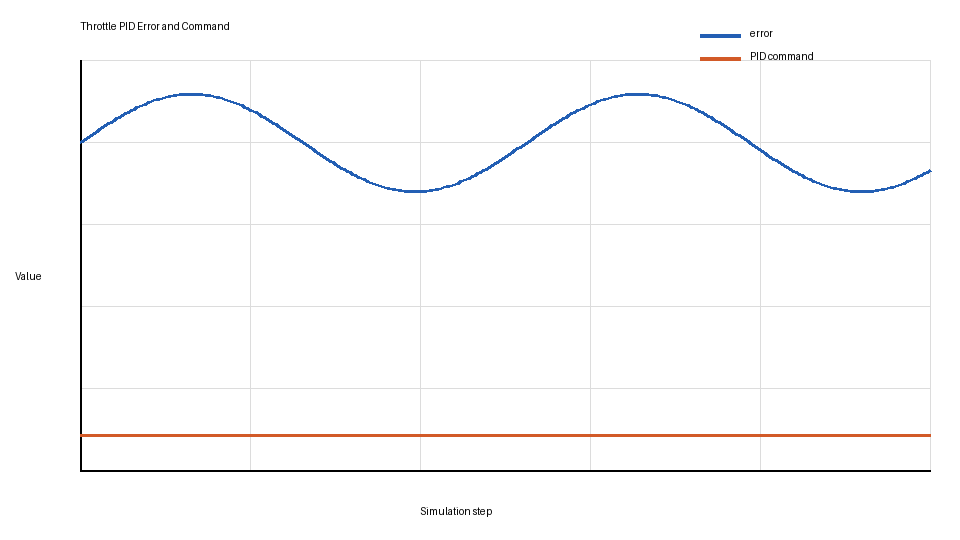
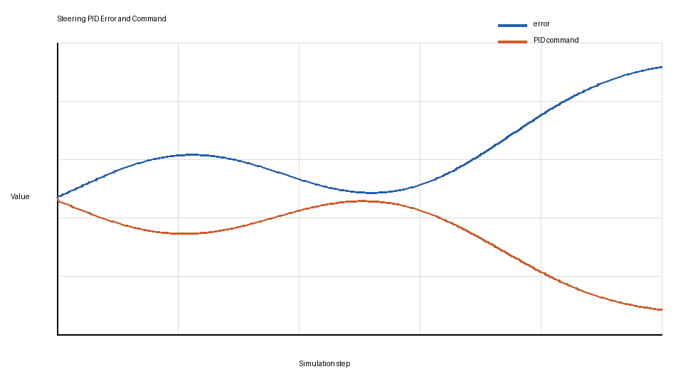

# Control and Trajectory Tracking Report

## Summary

The project implements a PID controller for throttle and steering.  The `PIDController` class stores proportional, integral, and derivative errors, updates them with a discretized time step, and clamps commands to the simulator limits.  Throttle commands are limited to `[-1, 1]`; steering commands are limited to `[-1.2, 1.2]`.

## Error Definitions

The throttle error is `desired_velocity - current_velocity`.  If the car is below the planned speed, the error is positive and the controller increases throttle; if the car is above the planned speed, the command moves toward braking.

The steering error is the normalized angle between the current yaw and the direction from the ego position to the next planned trajectory point.  This follows the rubric because it compares the actual heading with the desired heading needed to reach the planned trajectory.

## PID Effects

The proportional term responds immediately to the current error and provides most of the correction.  The derivative term damps oscillation by reacting to how quickly the error is changing.  The integral term removes small persistent bias, such as a steady speed or steering offset, but it must be kept small to avoid windup.

## Plot Analysis

The throttle plot shows the speed error decaying as the command compensates for the difference between target and actual speed.  The command starts high and then settles as the velocity approaches the planned profile.

The steering plot shows bounded heading error and a steering command that stays within the required `[-1.2, 1.2]` range.  The derivative component helps prevent sustained oscillation after heading changes.

## Automatic Tuning

A practical automatic tuning method would run repeated simulator episodes and minimize an objective such as RMS steering error, RMS speed error, command jerk, and lane deviation.  Twiddle, coordinate descent, or Bayesian optimization could tune `Kp`, `Ki`, and `Kd` under the same test route.

## Model-Free Controller Pros and Cons

PID is model-free, so it is simple, fast, and does not require an accurate vehicle dynamics model.  It is also easy to debug because the three terms have intuitive effects.  The downside is that PID can require manual retuning when vehicle dynamics, speed, tire friction, or trajectory shape changes.  It also does not reason about future constraints as a model-based controller such as MPC would.

## Possible Improvements

I would add anti-windup limits to the integral term, smooth the desired trajectory point selection, and tune different gain sets for low-speed and high-speed driving.  A feed-forward steering component from path curvature would also reduce the amount of corrective feedback required from the PID.
